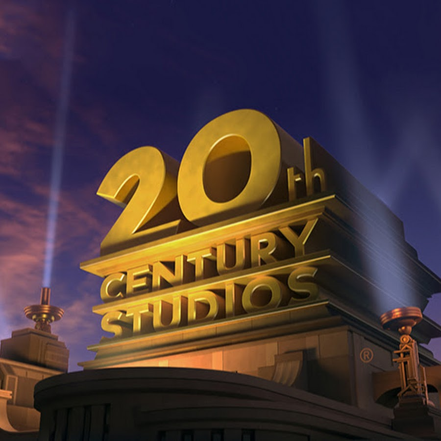
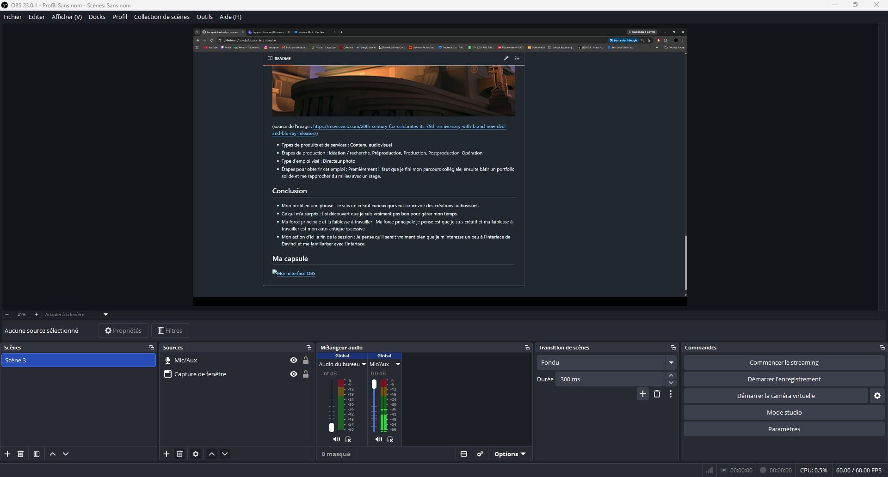

# Analyse du domaine — That Lukas Ton Rojas

## Découverte de soi

- Mes forces : créatif, logique, curieux 
    - Exemple : Je pense que j'ai de bonnes idées créatives et que je peux trouver de bonne direction artistique, également je pense que je peux atteindre des résultats de manière logique et cohérente, finalement dès qu'un sujet m'intéresse je suis particulièrement curieux et je peux m'informer sur celui-ci pendant                   longtemps.
- Mes faiblesses ou points à améliorer : Mauvaise gestion du temps, l'auto-critique excessive , la prise de risque limitée
    - Exemple : J'ai vraiment une très mauvaise gestion du temps, j'ai souvent de la misère à gérer tout mes travaux d'écoles et donc ils s'empilent et devient difficile à gérer. De plus je m'auto-critique beaucoup trop et reste acharné sur des détails qui importe peu et recherche trop un résultat qui va plaire. Dernièrement je reste souvent dans ma zone de confort et sort rarement des sentiers battus pour faire autrement ,malgré ma curiosité je refais souvent les mêmes choses.
- Seul(e) ou en équipe : En équipe
    - Pourquoi et exemple : Je pense que je sais plus me gérer quand je travaille en groupe. Tandis que quand je travail seul et que je suis le seul responsable de mon travail je gère mal mon temps et procrastine. 
- Plutôt technique ou créatif : Créatif

## Exploration des domaines

| Domaine | Intérêt | Pourquoi |
|---|---|---|
| Graphisme | fort | J'aime comment les choses peut nous faire ressentir des choses juste en les regardant. |
| Vidéo et animation 2D | fort | J'aime la vidéo, j'aime le cinéma et les vidéo-clips mais je ne m'intéresse pas forcément à l'animation 2D. |
| 3D | faible | Je n'ai jamais porté attention à la 3D. |
| Web | moyen | J'aime un peu le développement web mais ce n'est pas ce que je préfère dans le multimédia. |
| Jeux vidéo | moyen | J'aime passé mon temps à joué mais je n'ai pas spécialement l'envie d'en développer. |
| Développement logiciel | faible | La programmation est la partie qui m'intéresse le moins dans le domaine du multimédia |
| Installations et expériences immersives | moyen | Je n'ai jamais fait d'installations mais je sens que c'est un domaine qui pourrait m'intéresser. |

## Mes 2 domaines préférés

### Domaine 1 : Vidéo

- Expérience : Je n'ai pas d'expérience, ce qui est le plus favorable à m'y initier et tout ce qui touche au cinéma et au monde de la musique donc vidéo-clips.
- Logiciels et outils : Davinci
- Pourquoi il m'intéresse : Mon intérêt pour ce domaine est très fort puisque j'adore comment on peut transmettre des émotions seulement avec des images
- Travailler dans ce domaine : J'aimerais vraiment travailler dans un petit studio dans le cadre de si je travailler dans le cadre du monde la musique sinon dans sur de gros projet dans le cadre du cinéma.

### Domaine 2 : Graphisme

- Expérience : J'ai suivi un cours d'infographie durant mon secondaire et durant mon parcours collégiale j'ai eu l'occasion de suivre un cours d'illustration numérique. 
- Logiciels et outils :  photoshop, illustrator
- Pourquoi il m'intéresse : Mon intérêt pour ce domaine est très fort puisque j'adore comment on peut travailler la composition dans l'image.
- Travailler dans ce domaine : J'aimerais vraiment travailler dans un petit studio de graphisme et concevoir des identités visuelles.

## Les caractéristiques de mon domaine préféré

- Types d'entreprises : Studios de création audiovisuel
- Exemple d'entreprise : Lucasfilm, Paramount, Warner Bros, Sony Pictures

(source de l'image : https://movieweb.com/20th-century-fox-celebrates-its-75th-anniversary-with-brand-new-dvd-and-blu-ray-releases/)

- Types de produits et de services : Contenu audiovisuel
- Étapes de production : Idéation / recherche, Préproduction, Production, Postproduction, Opération 
- Type d'emploi visé : Directeur photo 
- Étapes pour obtenir cet emploi : Premièrement il faut que je fini mon parcours collégiale, ensuite bâtir un portfolio solide et me rapprocher du milieu avec un stage.

## Conclusion

- Mon profil en une phrase :  Je suis un créatif curieux qui veut concevoir des créations audiovisuels.
- Ce qui m'a surpris : J'ai découvert que je suis vraiment pas bon pour gérer mon temps.
- Ma force principale et la faiblesse à travailler : Ma force principale je pense est que je suis créatif et ma faiblesse à travailler est mon auto-critique excessive 
- Mon action d'ici la fin de la session : Je pense qu'il serait vraiment bien que je m'intéresse un peu à l'interface de Davinci et me familiariser avec l'interface.

## Ma capsule

